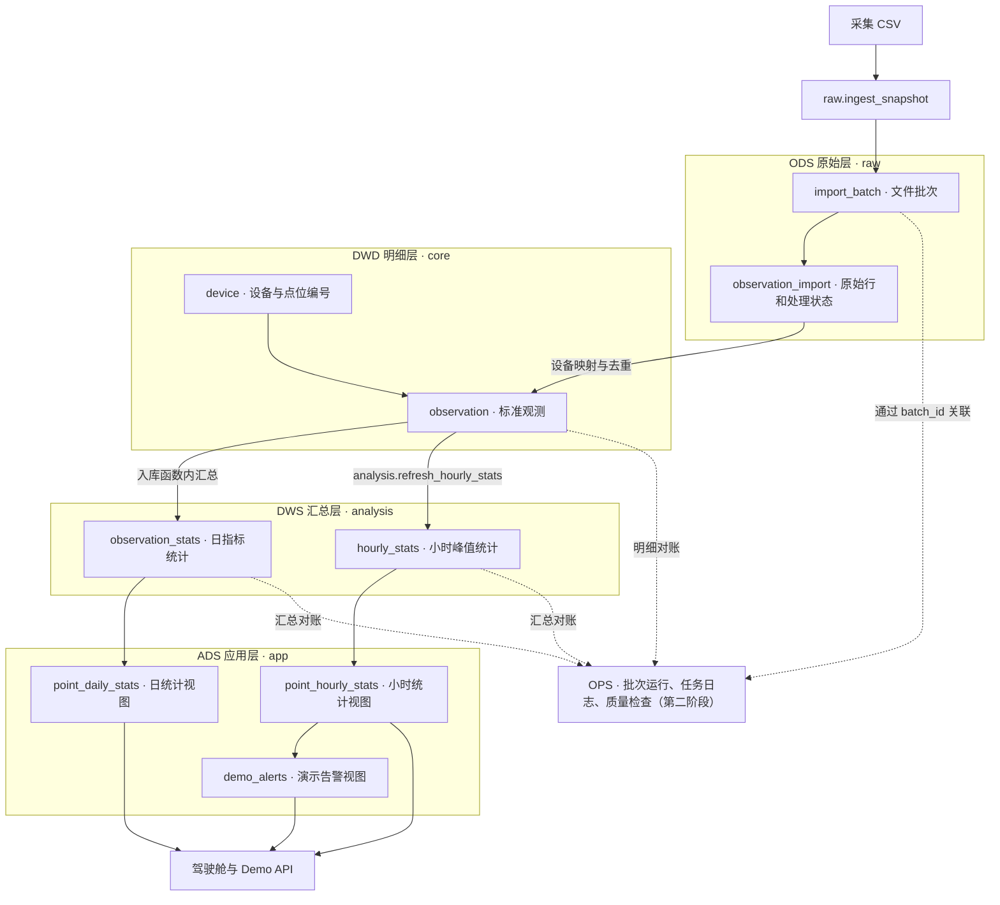

# 蚊媒监测平台数据库结构图

第一阶段交付物。结构以同目录的 [schema.sql](schema.sql) 为准，已在隔离的 PostgreSQL 兼容内存环境中核对对象、主外键和视图依赖。

## 数据流转

实线表示现有入库、汇总或视图读取路径。虚线表示第二阶段拟接入的 OPS 模块。ODS、DWD、DWS、ADS 是逻辑分层，物理 Schema 沿用现有名称。

## 核心表和键

| Schema | 表 | 主键 | 唯一键与外键 |
| --- | --- | --- | --- |
| `raw` | `import_batch` | `batch_id` | 唯一键 `(source_id, sha256)` |
| `raw` | `observation_import` | `(batch_id, line_no)` | `batch_id` → `raw.import_batch` |
| `core` | `device` | `device_id` | 唯一键 `(source_id, machine_no)` |
| `core` | `observation` | `(device_id, observed_at)` | `device_id` → `core.device`；`(batch_id, line_no)` → `raw.observation_import` |
| `analysis` | `observation_stats` | `(device_id, observation_day, point_no, is_demo, metric)` | `device_id` → `core.device` |
| `analysis` | `hourly_stats` | `(device_id, hour_local, point_no, is_demo)` | `device_id` → `core.device` |

两个应用统计视图分别读取日、小时汇总表，并通过 `device_id` 关联 `core.device`，补充来源和机器编号。演示告警视图从小时视图读取超过阈值的峰值。

## OPS 接入位置

- **批次运行**。复用 `raw.import_batch.batch_id` 作为文件批次标识，为每次处理或重跑保留独立运行记录。同一个文件批次可以关联多次运行。
- **任务日志**。关联运行记录，保存处理层级、开始和结束时间、处理行数、状态与失败原因。汇总任务另外记录影响的日期和小时。
- **质量检查**。关联运行和任务，保存规则、期望值、实际值及判定。明细异常可通过 `(batch_id, line_no)` 回溯原始行。

当前可从标准观测追到原始文件和行号。日、小时汇总可能覆盖多个入库批次，因此后续通过任务记录关联汇总范围和输入批次。首批验收用例可使用已在模拟数据中复现的重复导入、迟到补录、峰值更正和空分组残留。

本阶段沿用已验证的四个 Schema 和六张核心表。生产库部署状态待独立核对。
